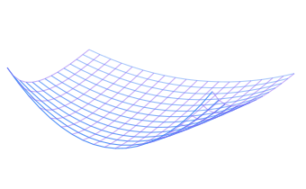

## Jared Crosby

Mathematician · quant researcher · AI research scientist

Mathematics first, applied to quantitative finance and AI. I study the statistics of financial data (covariance, volatility surfaces, market regimes and risk) and turn the models into software that holds up outside the notebook.

10+ years as a quant analyst, AI research scientist and software engineer.

 

**Projects**

- **Shrinkcov** · shrinkage covariance estimation for many assets and few observations
- **AlphaLab** · factor research and backtesting with walk-forward validation
- **Yield Curve Studio** · Treasury curve fitting and rate scenarios
- **Greeks Engine** · real-time options Greeks and VaR
- **VolSurf Net** · neural, arbitrage-free implied volatility surfaces
- **Regime Net** · deep-learning market regime detection

Python · NumPy · SciPy · pandas · PyTorch · scikit-learn · Numba · FastAPI · Kafka · Redis · PostgreSQL
